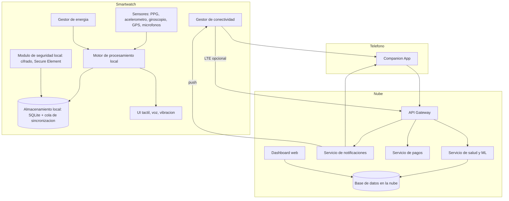
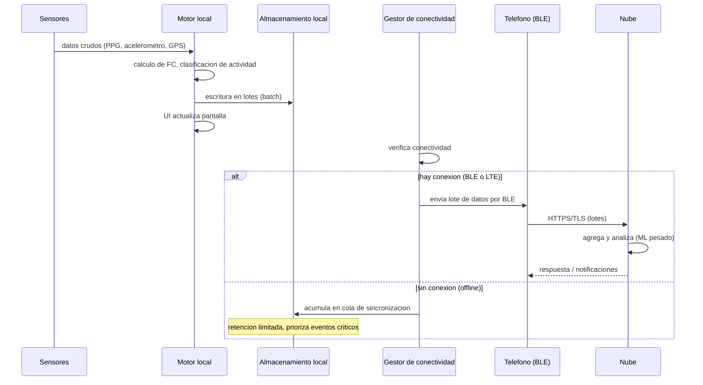
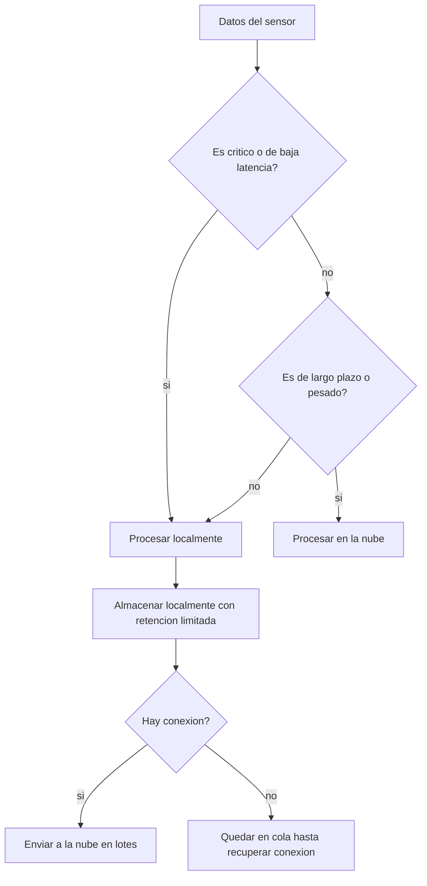
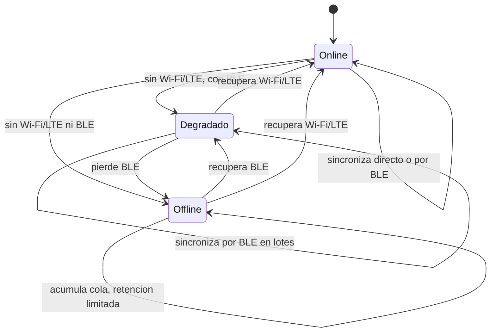

# Diagramas del modelo arquitectonico

## 1. Diagrama general de componentes

## 2. Flujo de datos de una sesion de actividad

## 3. Decision de procesamiento local vs nube

## 4. Diagrama de estados del modo de conectividad

