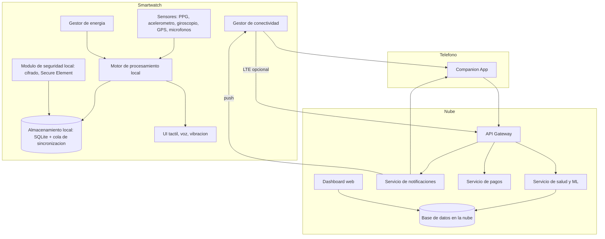
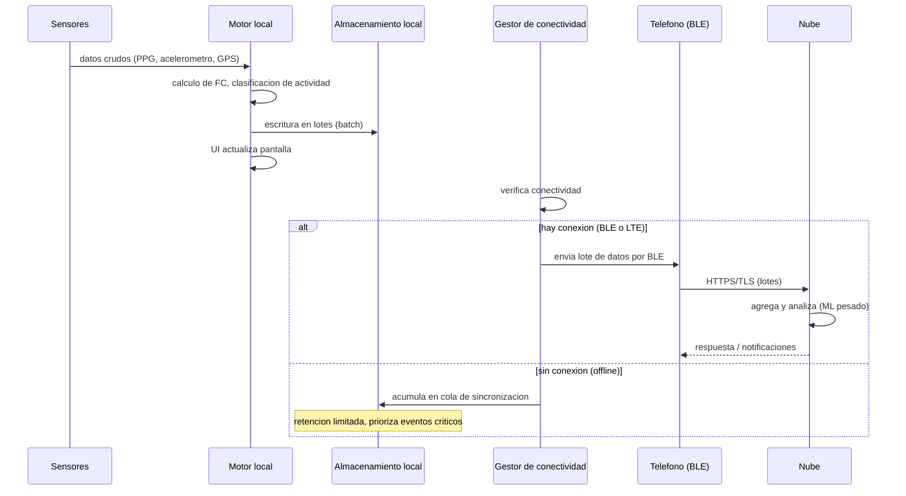
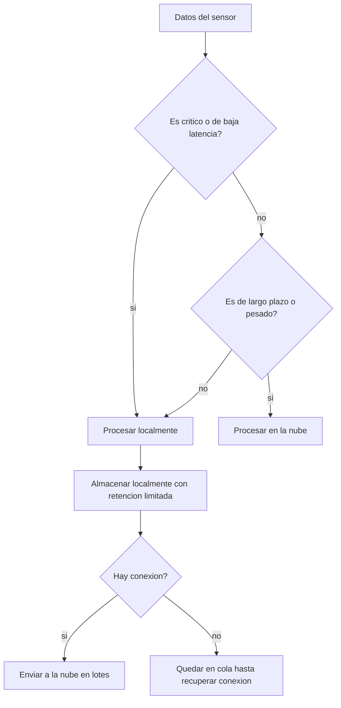
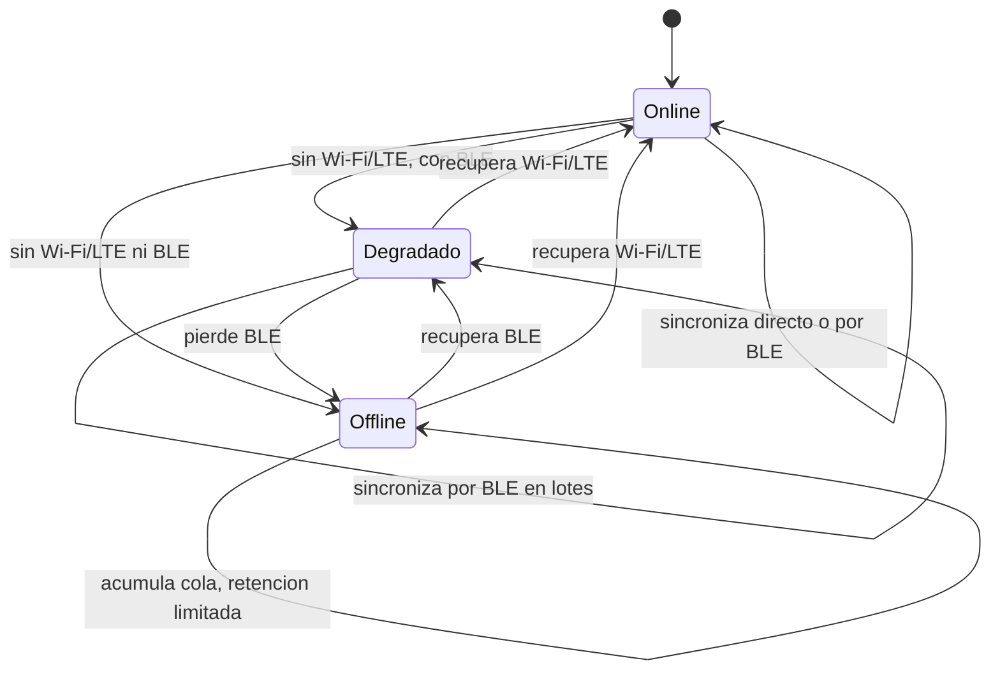

# Practica 2: Arquitectura de una aplicacion para dispositivo inteligente

## Entrega final

**Escenario seleccionado:** Reloj inteligente (Smartwatch)

**Equipo de desarrollo:** Empresa de desarrollo de software para dispositivos inteligentes

**Contenido de este documento:**

1. Analisis del problema
2. Componentes del sistema
3. Comunicacion entre componentes
4. Donde se procesa la informacion
5. Informacion que permanece localmente
6. Informacion que se envia a los servidores
7. Interaccion con el usuario
8. Mecanismos de seguridad
9. Comportamiento sin conexion a Internet
10. Modelo arquitectonico (diagramas)
11. Prototipo y resultados de ejecucion
12. Decisiones de arquitectura y justificacion
13. Riesgos y mitigaciones

---

## 1. Analisis del problema

Un reloj inteligente es un dispositivo embebido con restricciones severas de recursos:

- **Energia limitada:** bateria pequena, consumo medido en milivatios-hora; cada transmision de radio y cada ciclo de CPU consumen energia.
- **Memoria limitada:** tipicamente 1 a 4 GB de almacenamiento y 512 MB a 2 GB de RAM.
- **CPU de bajo consumo:** procesador de 1.2 a 1.8 GHz, sin aceleradores de computo pesado.
- **Sensores:** acelerometro, giroscopio, fotopletismografo (PPG), GPS, barometro, microfonos.
- **Interfaz:** pantalla tactil pequena, boton/corona, voz, vibracion (haptica).
- **Conectividad:** Bluetooth Low Energy (BLE), Wi-Fi (opcional), LTE (opcional), NFC.

El problema central es decidir **que se procesa localmente y que se delega a la nube**, minimizando el consumo de energia y garantizando que el dispositivo siga siendo util cuando no hay conexion.

### Objetivos de la arquitectura

1. Procesar en el dispositivo toda la informacion critica y de baja latencia (frecuencia cardiaca, deteccion de caida, notificaciones).
2. Delegar a la nube el procesamiento pesado (machine learning de salud, historial, copias de seguridad).
3. Operar de forma autònoma sin Internet (modo offline).
4. Proteger datos sensibles de salud (cumplimiento tipo GDPR/HIPAA).
5. Minimizar el consumo de energia mediante procesamiento local y sincronizacion por lotes.

---

## 2. Componentes del sistema

### 2.1 Capa de hardware (smartwatch)

| Componente | Funcion |
|------------|---------|
| MCU/CPU de bajo consumo | Ejecuta el sistema operativo y los servicios locales |
| Memoria RAM | Estado en ejecucion, colas de eventos |
| Almacenamiento flash | Base de datos local, modelos ligeros, cache |
| Sensores | PPG (frecuencia cardiaca), acelerometro, giroscopio, GPS, microfonos |
| Pantalla tactil | Interaccion visual principal |
| Boton/corona | Interaccion alternativa con una mano |
| Modulo Bluetooth | Canal principal con el telefono |
| Modulo Wi-Fi/LTE | Conexion directa a Internet (opcional) |
| NFC | Pagos y acceso |
| Bateria | Fuente de energia, monitorizada por el sistema |

### 2.2 Capa de software del dispositivo (on-device)

1. **Sistema operativo embebido (RTOS/micro-OS):** gestiona memoria, energia y permisos.
2. **Driver de sensores:** lee datos crudos y los normaliza.
3. **Motor de procesamiento local:**
   - Calculo de frecuencia cardiaca y SpO2.
   - Deteccion de caida (acelerometro + giroscopio).
   - Reconocimiento de actividad (caminar, correr, dormir) con un modelo ML ligero.
   - Gestion de notificaciones (reenvio desde el telefono).
4. **Almacenamiento local (base de datos embebida, p. ej. SQLite):**
   - Registros de actividad de los ultimos 7 dias.
   - Eventos criticos (caida, alertas de salud).
   - Cola de sincronizacion (datos pendientes de enviar).
5. **Gestor de conectividad:** detecta el estado de BLE/Wi-Fi/LTE y decide cuando sincronizar.
6. **Gestor de energia:** reduce la frecuencia de muestreo, apaga GPS y pantalla en modo reposo.
7. **Modulo de seguridad local:** cifrado en reposo, almacenamiento seguro de claves, verificacion de integridad del firmware.
8. **Capa de interaccion con el usuario:** UI tactil, voz, vibracion, reloj de actividad.

### 2.3 Capa intermedia (companion app en el telefono)

- Recibe datos del reloj por Bluetooth (BLE) cuando el reloj no tiene conexion directa.
- Sirve de puente hacia la nube cuando el reloj no tiene LTE.
- Muestra historial y permite la configuracion de la cuenta.

### 2.4 Capa de nube (backend)

| Servicio | Funcion |
|----------|---------|
| API Gateway | Autenticacion, rate limiting, enrutamiento |
| Servicio de salud | Agrega y analiza datos (tendencias, ML pesado) |
| Base de datos en la nube | Historial completo, copias de seguridad |
| Servicio de notificaciones | Alertas remotas (caida con llamada de emergencia) |
| Servicio de pagos (NFC) | Procesamiento de transacciones |
| Dashboard web | Visualizacion para el usuario |

---

## 3. Comunicacion entre componentes

- **Sensores -> Motor local:** eventos en tiempo real por bus interno (colas de mensajes).
- **Motor local -> Almacenamiento local:** escritura en lotes (batch) para ahorrar energia.
- **Reloj -> Telefono:** Bluetooth Low Energy, envio por lotes de datos pendientes.
- **Telefono -> Nube:** HTTPS/TLS, envio por lotes cuando hay conexion estable.
- **Nube -> Reloj/Telefono:** notificaciones push (mensajes pequenos, solo cuando hay conexion).
- **Reloj -> Nube directo:** solo si el modelo tiene LTE, para emergencias (llamada de emergencia por caida).

### Protocolos y formatos

- BLE con perfiles estandar (p. ej. Health Thermometer / Heart Rate).
- JSON o protobuf para los paquetes de datos.
- TLS 1.2 o superior en todo trafico hacia la nube.
- Mensajes pequenos y comprimidos para reducir energia de radio.

### Modos de conectividad

| Modo | Canal disponible | Sincronizacion |
|------|------------------|----------------|
| online | Wi-Fi o LTE | Directa a la nube, en lotes |
| degradado | Solo BLE con el telefono | A traves del companion app |
| offline | Ninguno | Se acumula en la cola local |

---

## 4. Donde se procesa la informacion

| Dato | Proceso local | Proceso en la nube |
|-------|---------------|--------------------|
| Frecuencia cardiaca en vivo | Si (baja latencia, pantalla) | No |
| Deteccion de caida | Si (critico, debe funcionar sin red) | No |
| Clasificacion de actividad (caminar/correr) | Si (modelo ML ligero) | No |
| Tendencia de salud a largo plazo | No | Si (ML pesado, historial) |
| Copia de seguridad e historial | No | Si |
| Pagos NFC | Verificacion local + confirmacion en la nube | Si |
| Llamada de emergencia por caida | Disparo local; ejecucion directa si hay LTE, si no, via telefono | Servicio de notificaciones |

**Regla general:** lo critico y de baja latencia se procesa localmente; lo pesado y de largo plazo se procesa en la nube.

---

## 5. Que informacion permanece localmente

- Registros de actividad de los ultimos 7 dias (retencion limitada por memoria).
- Eventos criticos (caidas, alertas de salud) hasta que se sincronizen.
- Cola de sincronizacion (datos pendientes de enviar).
- Preferencias del usuario y configuracion de la cuenta.
- Claves de cifrado (en el almacenamiento seguro del hardware, Secure Element).
- Modelos ML ligeros (clasificacion de actividad).

La retencion es limitada porque la memoria del reloj es pequena; el historial completo vive en la nube.

---

## 6. Que informacion se envia a los servidores

- Registros de actividad y salud agregados (promedios por hora/dia, no siempre datos crudos).
- Eventos criticos (caida, alertas) para activar notificaciones.
- Datos de transaccion (pagos NFC).
- Telemetria anonima de rendimiento (opcional, con consentimiento).
- Credenciales de verificacion (token de autenticacion, nunca la contrasena en claro).

**No se envian:** datos crudos continuos (ahorra energia y protege privacidad), contrasenas, claves privadas.

---

## 7. Interaccion con el usuario

| Canal | Uso |
|-------|-----|
| Pantalla tactil | Navegacion principal, ver metricas, responder notificaciones |
| Boton/corona | Acciones de una mano (iniciar actividad, silenciar) |
| Voz (asistente) | Consultas ("cuanto dormi?"), iniciar actividades |
| Vibracion (haptica) | Alertas y confirmaciones |
| Pagos NFC | Aproximar el reloj a la terminal de pago |
| Llamada de emergencia | Automatica por caida, o manual con el boton |

Principios de UX:

- Acciones criticas accesibles con una sola mano.
- Retroalimentacion inmediata (visual, haptica y de voz).
- Minimo consumo de pantalla (modo siempre visible de bajo brillo).

---

## 8. Mecanismos de seguridad

1. **Cifrado en reposo:** la base de datos local se cifra con una clave almacenada en el modulo seguro del hardware (Secure Element).
2. **Cifrado en transito:** TLS para todo trafico a la nube y BLE cifrado hacia el telefono.
3. **Autenticacion:** token OAuth2 o JWT para la cuenta; la contrasena nunca se guarda en el reloj.
4. **Verificacion de integridad:** firma del firmware para evitar tampering; hash de integridad en los paquetes transmitidos.
5. **Permisos minimos:** los sensores solo se activan cuando una funcion los requiere.
6. **Minimizacion de datos:** se envian agregados, no datos crudos, salvo eventos criticos.
7. **Consentimiento:** el usuario puede desactivar la telemetria y ver que datos se comparten.
8. **Borrado remoto:** si el dispositivo se pierde, se puede borrar la informacion de la cuenta.
9. **Rate limiting y auditoria** en la nube para detectar abuso.

---

## 9. Que sucede cuando no existe conexion a Internet (modo offline)

1. **Los servicios locales siguen activos:** frecuencia cardiaca, actividad, notificaciones locales, alarma, pagos NFC con saldo local verificado.
2. **Los datos se acumulan en la cola de sincronizacion** en el almacenamiento local.
3. **Politica de retencion:** si la cola supera el limite (p. ej. 7 dias), se descartan los registros menos criticos, conservando siempre los eventos de salud.
4. **La deteccion de caida sigue funcionando** y activa la llamada de emergencia solo si existe alguna ruta de red (LTE o telefono); si no, se guarda el evento y se notifica al usuario localmente.
5. **Al recuperar conexion:**
   - Se sincroniza la cola en lotes, priorizando eventos criticos.
   - Se descargan actualizaciones de configuracion y notificaciones pendientes.
   - Se actualizan los modelos ML si hay versiones nuevas (descarga diferida).
6. **Gestion de energia en offline:** se reduce la frecuencia de muestreo de sensores para alargar la bateria, ya que no hay necesidad de transmitir.

---

## 10. Modelo arquitectonico (diagramas)

### 10.1 Diagrama general de componentes



### 10.2 Flujo de datos de una sesion de actividad



### 10.3 Decision de procesamiento local vs nube



### 10.4 Estados del modo de conectividad



---

## 11. Prototipo y resultados de ejecucion

El prototipo (`src/prototype.py`) simula todos los componentes del sistema y su comunicacion:

- `Sensors`: drivers de sensores (PPG, acelerometro, GPS).
- `LocalProcessor`: motor de procesamiento local (frecuencia cardiaca, alertas, caida).
- `LocalStorage`: almacenamiento local con cola de sincronizacion y retencion limitada.
- `ConnectivityManager`: modos online / degradado / offline.
- `Phone` y `Cloud`: companion app y backend en la nube.
- `SecurityModule`: cifrado de payloads y verificacion de integridad.
- `Smartwatch`: orquestador que integra el flujo completo.
- `WatchUI`: capa de interaccion (pantalla, vibracion, voz).

Comando de ejecucion:

```bash
python src/prototype.py
```

Salida obtenida:

```text
=== Simulacion de smartwatch ===
Pasos simulados: 60

--- Escenario: online (Wi-Fi) ---
  estado: modo=online pendientes=0
  almacenamiento local: {'records': 15, 'avg_hr': 78.9}

--- Escenario: degradado (solo BLE) ---
  estado: modo=degraded pendientes=0
  almacenamiento local: {'records': 30, 'avg_hr': 80.2}

--- Escenario: offline (sin red) ---
  estado: modo=offline pendientes=15
  almacenamiento local: {'records': 45, 'avg_hr': 79.2}

--- Escenario: online (LTE) ---
  estado: modo=online pendientes=0
  almacenamiento local: {'records': 60, 'avg_hr': 79.2}

=== Resultado final ===
UI ultima lectura: {'hr': 89, 'activity': 'walking'}
Almacenamiento local: {'records': 60, 'avg_hr': 79.2}
Nube: {'records_received': 60, 'critical_events_received': 0, 'avg_hr': 79.2}
```

Interpretacion:

| Escenario | Modo | Pendientes | Comportamiento |
|-----------|------|-----------|----------------|
| online (Wi-Fi) | online | 0 | Sincronizacion inmediata a la nube |
| degradado (solo BLE) | degraded | 0 | Sincronizacion a traves del telefono |
| offline (sin red) | offline | 15 | Datos acumulados en la cola local |
| online (LTE) | online | 0 | Cola pendiente sincronizada al recuperar conexion |

La nube recibe 60 registros en total: todo lo almacenado localmente termino sincronizado, confirmando el comportamiento esperado de la arquitectura.

---

## 12. Decisiones de arquitectura y justificacion

| Decision | Justificacion |
|----------|---------------|
| Arquitectura en capas (hardware / on-device / telefono / nube) | Separa responsabilidades y permite degradacion gradual |
| Procesamiento local de lo critico | Latencia minima y funcionamiento sin red |
| Sincronizacion por lotes | Ahorra energia de radio y bateria |
| Retencion local limitada (7 dias) | Memoria pequena; lo historico vive en la nube |
| Cifrado en reposo y en transito | Los datos de salud son sensibles |
| Companion app como puente | No todo modelo tiene LTE; el telefono es el enlace natural |
| Modelos ML ligeros en el dispositivo | Clasificacion de actividad sin depender de la nube |
| Cola de sincronizacion con priorizacion | No se pierden eventos criticos sin red |

---

## 13. Riesgos y mitigaciones

| Riesgo | Mitigacion |
|--------|------------|
| Bateria se agota rapidamente | Gestor de energia, muestreo adaptativo, BLE de baja potencia |
| Falta de conexion prolongada | Cola local con retencion limitada y priorizacion de eventos criticos |
| Fuga de datos de salud | Cifrado, minimizacion de datos, consentimento, borrado remoto |
| Firmware comprometido | Verificacion de firmas, actualizaciones firmadas |
| Memoria insuficiente | Retencion limitada, agregacion en lugar de datos crudos |

---

## Estructura del repositorio

```
Practica2SmartWatch/
├── README.md               # Resumen y como ejecutar
├── docs/
│   ├── arquitectura.md     # Propuesta arquitectonica completa
│   ├── diagramas.md        # Diagramas del modelo (Mermaid)
│   ├── ejecucion.md        # Salida del prototipo e interpretacion
│   └── entrega_final.md    # Este documento
└── src/
    ├── prototype.py        # Prototipo de la arquitectura
    └── requirements.txt    # Sin dependencias externas (Python 3.9+)
```
